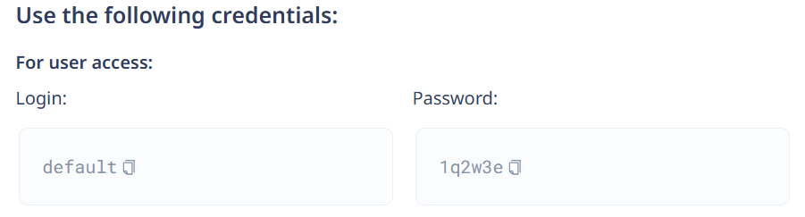

## Project Description
This is a simple Java Maven project for demonstration

## Jenkins Job
Jenkins job Link for this project:

[http://localhost:8080/job/MyJavaTestProject-MBP/](http://localhost:8080/job/MyJavaTestProject-MBP/)

## Reusable workflow
This project uses a reusable workflow for PR integrity checks.

[.github/workflows/pr-integrity.yml](https://github.com/Maverick-Joy/reusable-workflows/blob/main/.github/workflows/pr-integrity.yml)

## SonarQube Integration
This project is integrated with SonarQube for code quality analysis. The SonarQube server is running on [Maverick-Joy_SampleJavaProject](https://sonarcloud.io/project/overview?id=Maverick-Joy_SampleJavaProject)

## Report Portal Integration
This project is integrated with Report Portal on [localhost:8082](http://localhost:8082/ui/#default_personal/launches/all)

[Report Portal credentials can be fetched from here](https://reportportal.io/installation/)

Steps:

1. Open Docker Decktop
2. Run 'docker compose -p reportportal up -d' command at "C:\reportportal" path in local before running any tests

Use below command to run the tests in local

mvn clean test -U -B -Djava.version=<java-version> -Drp.endpoint="http://localhost:8082" -Drp.api.key="<my-rp-api-key>" -Drp.project="default_personal" -Drp.launch="sample-java-tests-run" -Drp.description="TestNG run of SampleJavaProject" -Drp.attributes="build:local;env:qa" -Drp.enable=true -Drp.reporting.async=true